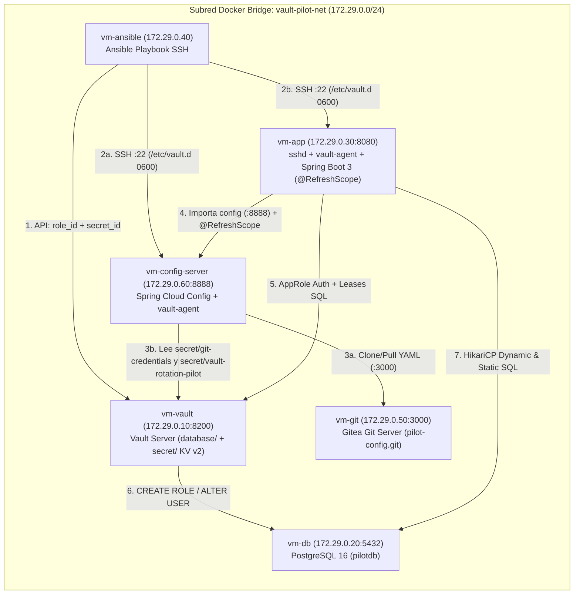

# Piloto HashiCorp Vault + Gitea + Spring Cloud Config + Ansible + Spring Boot 3 + PostgreSQL 16

> **¿Primera vez viendo este proyecto?**
> - 👉 **[Manual Completo "Para Dummies" (`docs/HOWTO-DUMMIES.md`)](docs/HOWTO-DUMMIES.md)**: Analogías sencillas, diagramas Mermaid de arquitectura con las 6 máquinas, guía de la consola web y preguntas frecuentes.
> - 🛠️ **[Guía de Comandos 1 por 1 "Para Dummies" (`docs/PASO-A-PASO-COMANDOS.md`)](docs/PASO-A-PASO-COMANDOS.md)**: Todos los comandos numerados 1 por 1 hasta tener todo montado (tanto el Recorrido A con Docker contenedor a contenedor como el Recorrido B con los comandos internos reales de PostgreSQL, Gitea, Vault, Spring Cloud Config, Ansible y Spring Boot).

---

## Qué demuestra este piloto

Este laboratorio despliega **6 contenedores que simulan máquinas virtuales** en la subred estática `172.29.0.0/24` para probar de extremo a extremo la **negociación de identidad AppRole**, la **rotación automática y bajo demanda de claves de base de datos** y la **centralización y recarga en caliente (`@RefreshScope`) de configuración desde Gitea + HashiCorp Vault con Spring Cloud Config Server**, todo sin reiniciar la aplicación Java:

1. **Aprovisionamiento automatizado con Ansible sobre SSH:** `vm-ansible` solicita el `role_id` y genera `secret_id` únicos contra la API de Vault, y los inyecta por SSH tanto en `vm-config-server` como en `vm-app` (`/etc/vault.d/role_id` y `/etc/vault.d/secret_id` con permisos `0600`).
2. **Servidor Git Gitea ligero (`vm-git` en `http://localhost:13000`):** arranca auto-inicializado con SQLite3, crea el usuario `pilot-admin` y el repositorio `pilot-admin/pilot-config` con el fichero `vault-rotation-pilot.yml`.
3. **Spring Cloud Config Server (`vm-config-server` en `http://localhost:18888`) con Composite Backend (`git` + `vault`):** su `vault-agent` local obtiene de Vault (`secret/data/git-credentials`) el usuario/contraseña de Gitea sin tener contraseñas hardcodeadas en su imagen, y sirve combinados los ficheros YAML de Gitea junto con los secretos KV v2 de `secret/data/vault-rotation-pilot`.
4. **Doble estrategia de rotación en PostgreSQL (`vm-db`):**
   - **Rol Dinámico (`postgres-dynamic-role`, TTL 60s):** crea y destruye usuarios SQL efímeros (`v-approle-postgres-...`).
   - **Rol Estático (`postgres-static-role`, rotación 60s):** mantiene el usuario fijo `app_static_user` rotando automáticamente su contraseña en PostgreSQL.
5. **Hot-Reload de `HikariCP` + `@RefreshScope` en Java 21 Spring Boot 3 (`vm-app`):** `RotatableDataSourceManager` recarga los pools SQL sin perder consultas cuando rotan las claves, y `SpringCloudConfigService` permite hacer un nuevo commit en Gitea, rotar secretos KV en Vault y ejecutar `ContextRefresher.refresh()` en caliente.
6. **Consola Web Animada (`http://localhost:18080`):** interfaz visual en tiempo real con mapa SVG de las 6 máquinas virtuales, partículas animadas, visor de contraseñas y botones para forzar rotaciones SQL y commits + `@RefreshScope` en un clic.

---

## Arquitectura General (`172.29.0.0/24`)



| Máquina Virtual (Contenedor) | IP Interna | Puerto en Host | Función Principal |
| :--- | :--- | :--- | :--- |
| **`vm-vault`** | `172.29.0.10` | `18200 -> 8200` | HashiCorp Vault Server 1.17 (`file` storage), motores `database/`, `secret/` (KV v2) y `auth/approle`. |
| **`vm-db`** | `172.29.0.20` | `15432 -> 5432` | PostgreSQL 16 (`pilotdb`), tabla `public.connection_audit_log`, usuarios `vault_admin` y `app_static_user`. |
| **`vm-app`** | `172.29.0.30` | `18080 -> 8080` | App Java 21 Spring Boot 3 + Spring Cloud Config Client (`@RefreshScope`) + `vault-agent` + Consola Web Animada. |
| **`vm-ansible`** | `172.29.0.40` | — | Nodo de control Ansible que aprovisiona AppRole por SSH en `vm-config-server` y `vm-app`. |
| **`vm-git`** | `172.29.0.50` | `13000 -> 3000` | Servidor Git **Gitea** ligero con SQLite3 y repositorio `pilot-admin/pilot-config` (`vault-rotation-pilot.yml`). |
| **`vm-config-server`** | `172.29.0.60` | `18888 -> 8888` | **Spring Cloud Config Server** (`@EnableConfigServer`) + `vault-agent` con Composite Backend (`git` + `vault`). |

---

## Arranque Rápido (3 pasos)

> 💡 ¿Prefieres levantar cada máquina **1 por 1** o ejecutar manualmente todos los comandos internos de configuración? Sigue la **[Guía de Comandos 1 por 1 (`docs/PASO-A-PASO-COMANDOS.md`)](docs/PASO-A-PASO-COMANDOS.md)**.

```bash
# 1. Construir y levantar las 6 VMs en segundo plano
docker compose up -d --build

# 2. Abrir las interfaces web en tu navegador:
#    👉 Consola Animada del Piloto: http://localhost:18080
#    👉 Servidor Git Gitea:         http://localhost:13000  (user: pilot-admin / pass: gitea_secret_password_2026)
#    👉 Spring Cloud Config JSON:   http://localhost:18888/vault-rotation-pilot/default

# 3. Ejecutar los scripts de verificacion extremo a extremo
bash scripts/verify-ui.sh
bash scripts/verify-pilot.sh
```

---

## Estructura del Proyecto

```text
vault/
├── docker-compose.yml                  # Topologia de 6 contenedores VM en 172.29.0.0/24
├── README.md                           # Resumen ejecutivo y arranque rapido
├── docs/
│   ├── HOWTO-DUMMIES.md                # Manual conceptual e interactivo con diagramas Mermaid
│   └── PASO-A-PASO-COMANDOS.md         # Guia de comandos 1 por 1 (Docker paso a paso + comandos internos)
├── infra/
│   ├── db/
│   │   └── init.sql                    # Esquema PostgreSQL, tabla de auditoria y roles base
│   ├── git/
│   │   ├── Dockerfile                  # Imagen ligera de Gitea + SQLite3 para vm-git (172.29.0.50)
│   │   └── bootstrap-gitea.sh          # Auto-init de Gitea, usuario pilot-admin y repo pilot-config
│   ├── vault/
│   │   ├── config.hcl                  # Configuracion Vault Server con storage file
│   │   ├── policies/app-db-policy.hcl  # Politica ACL para database/ y secret/ (KV v2)
│   │   └── scripts/bootstrap-vault.sh  # Auto-init, unseal, roles PostgreSQL, KV v2 y AppRole
│   ├── config-server/
│   │   ├── Dockerfile                  # Imagen VM para Spring Cloud Config Server + sshd + vault-agent
│   │   ├── entrypoint.sh               # Espera AppRole, renderiza credenciales Git y lanza Config Server
│   │   ├── vault-agent.hcl             # Configuracion Auto-Auth AppRole y sink de token
│   │   └── templates/git-creds.properties.ctmpl # Plantilla para secret/data/git-credentials
│   ├── ansible/
│   │   ├── Dockerfile                  # Imagen nodo de control Ansible
│   │   ├── inventory.ini               # Inventario SSH apuntando a vm-config-server y vm-app
│   │   └── playbooks/deploy-approle.yml# Obtiene role_id + secret_id y los inyecta en ambas VMs
│   └── app-vm/
│       ├── Dockerfile                  # Imagen multi-stage (Vault bin + Maven build + OpenJDK 21 + sshd)
│       ├── entrypoint.sh               # Arranca sshd, supervisa vault-agent, espera Config Server y lanza App
│       ├── vault-agent.hcl             # Configuracion Auto-Auth AppRole y renderizado cada 10s
│       └── templates/                  # Plantillas .ctmpl para db-dynamic y db-static.properties
├── config-server/
│   ├── pom.xml                         # Proyecto Maven Spring Cloud Config Server (Java 21)
│   └── src/main/
│       ├── java/com/pilot/configserver/ConfigServerApplication.java
│       └── resources/application.yml   # Composite Backend (Gitea Git + HashiCorp Vault KV v2)
├── app/
│   ├── pom.xml                         # Proyecto Maven Spring Boot 3.3.5 + Config Client + Actuator + JDBC
│   └── src/main/
│       ├── java/com/pilot/vault/
│       │   ├── VaultPilotApplication.java
│       │   ├── config/RotatableDataSourceManager.java  # Hot-reload de HikariCP por hash SHA-256
│       │   ├── config/DynamicConfigProperties.java     # Bean @RefreshScope con propiedades de Gitea y Vault KV
│       │   ├── service/DbRotationProbeService.java     # Inserciones SQL cada 5s y telemetria
│       │   ├── service/VaultControlService.java        # Estado de las 6 VMs y rotacion manual SQL
│       │   ├── service/SpringCloudConfigService.java   # Commit API Gitea + rotacion KV + ContextRefresher
│       │   └── controller/PilotDashboardController.java# Endpoints REST (/api/pilot/*)
│       └── resources/
│           ├── application.yml
│           └── static/                 # Consola Web Animada de 6 nodos (index.html, styles.css, app.js)
├── scripts/
│   ├── verify-pilot.sh                 # Verificacion CLI extremo a extremo de las 6 VMs, SQL y @RefreshScope
│   └── verify-ui.sh                    # Verificacion CLI de la consola web y endpoints REST
└── specs/
    ├── 01-vault-rotacion-claves-bbdd.md        # SPEC 01 (Implemented)
    ├── 02-web-animada-arquitectura-vault.md    # SPEC 02 (Implemented)
    ├── 03-readme-howto-dummies.md              # SPEC 03 (Implemented)
    ├── 04-guia-comandos-paso-a-paso-dummies.md # SPEC 04 (Implemented)
    └── 05-git-server-spring-cloud-vault.md     # SPEC 05 (Implemented)
```

---

## Documentación y Especificaciones

- 🛠️ **[Guía de Comandos 1 por 1 "Para Dummies" (`docs/PASO-A-PASO-COMANDOS.md`)](docs/PASO-A-PASO-COMANDOS.md)**
- 📘 **[Manual Completo "Para Dummies" (`docs/HOWTO-DUMMIES.md`)](docs/HOWTO-DUMMIES.md)**
- 📋 **[SPEC 01 — Piloto de negociación y rotación de claves BBDD](specs/01-vault-rotacion-claves-bbdd.md)**
- 🖥️ **[SPEC 02 — Consola web animada de arquitectura y rotación en vivo](specs/02-web-animada-arquitectura-vault.md)**
- 📖 **[SPEC 03 — Documentación README y guía How-To para Dummies](specs/03-readme-howto-dummies.md)**
- 🔢 **[SPEC 04 — Guía de comandos 1 por 1 para Dummies](specs/04-guia-comandos-paso-a-paso-dummies.md)**
- 🌐 **[SPEC 05 — Servidor Git Gitea + Spring Cloud Config Server + Vault](specs/05-git-server-spring-cloud-vault.md)**
