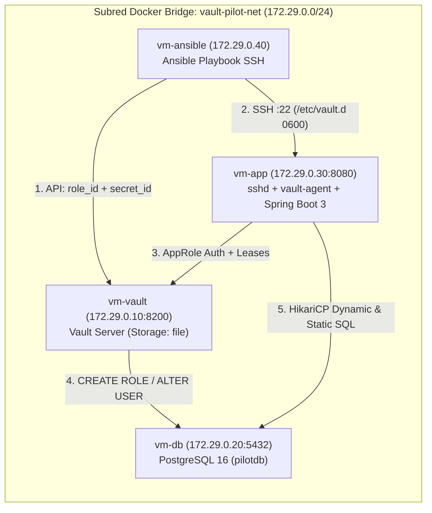

# Piloto HashiCorp Vault + Ansible + Spring Boot 3 + PostgreSQL 16

> **¿Primera vez viendo este proyecto?**
> 👉 **[Lee aquí el Manual Completo "Para Dummies" (`docs/HOWTO-DUMMIES.md`)](docs/HOWTO-DUMMIES.md)** con analogías sencillas, gráficos paso a paso, guía de la consola web y recetario de comandos sin dar nada por sentado.

---

## Qué demuestra este piloto

Este laboratorio despliega **4 contenedores que simulan máquinas virtuales** en la subred estática `172.29.0.0/24` para probar de extremo a extremo la **negociación de identidad AppRole** y la **rotación automática y bajo demanda de claves de base de datos** sin reiniciar la aplicación Java:

1. **Aprovisionamiento automatizado con Ansible sobre SSH:** `vm-ansible` solicita el `role_id` y genera un `secret_id` único contra la API de Vault, y los inyecta por SSH en `vm-app` (`/etc/vault.d/role_id` y `/etc/vault.d/secret_id` con permisos `0600`).
2. **Desacoplamiento con Vault Agent:** el demonio `vault-agent` en `vm-app` se autentica vía AppRole, mantiene vivo el token y renderiza en disco `/run/secrets/db-dynamic.properties` y `/run/secrets/db-static.properties`.
3. **Doble estrategia de rotación en PostgreSQL:**
   - **Rol Dinámico (`postgres-dynamic-role`, TTL 60s):** crea y destruye usuarios SQL efímeros (`v-approle-postgres-...`).
   - **Rol Estático (`postgres-static-role`, rotación 60s):** mantiene el usuario fijo `app_static_user` rotando automáticamente su contraseña en PostgreSQL.
4. **Hot-Reload de `HikariCP` en Java 21 Spring Boot 3:** `RotatableDataSourceManager` detecta cambios SHA-256 en `/run/secrets/*.properties`, abre un nuevo pool con las credenciales recién rotadas y drena el pool anterior sin perder ni una sola consulta SQL.
5. **Consola Web Animada (`http://localhost:18080`):** interfaz visual en tiempo real con mapa SVG de la arquitectura, partículas animadas de intercambio de paquetes, visor de contraseñas y botones para forzar rotaciones en vivo.

---

## Arquitectura General (`172.29.0.0/24`)



| Máquina Virtual (Contenedor) | IP Interna | Puerto en Host | Función Principal |
| :--- | :--- | :--- | :--- |
| **`vm-vault`** | `172.29.0.10` | `18200 -> 8200` | HashiCorp Vault Server 1.17 (`file` storage), `init`/`unseal` automático, motor `database/` y `auth/approle`. |
| **`vm-db`** | `172.29.0.20` | `15432 -> 5432` | PostgreSQL 16 (`pilotdb`), tabla `public.connection_audit_log`, usuarios `vault_admin` y `app_static_user`. |
| **`vm-app`** | `172.29.0.30` | `18080 -> 8080` | `openssh-server`, `vault-agent`, plantillas `.ctmpl` y app Java 21 Spring Boot 3 + Consola Web Animada. |
| **`vm-ansible`** | `172.29.0.40` | — | Nodo de control Ansible que ejecuta `deploy-approle.yml` contra `vm-vault` y `vm-app`. |

---

## Arranque Rápido (3 pasos)

```bash
# 1. Construir y levantar las 4 VMs en segundo plano
docker compose up -d --build

# 2. Abrir la consola web animada en tu navegador
#    👉 http://localhost:18080

# 3. Ejecutar los scripts de verificacion extremo a extremo
bash scripts/verify-ui.sh
bash scripts/verify-pilot.sh
```

---

## Estructura del Proyecto

```text
vault/
├── docker-compose.yml                  # Topologia de 4 contenedores VM en 172.29.0.0/24
├── README.md                           # Resumen ejecutivo y arranque rapido
├── docs/
│   └── HOWTO-DUMMIES.md                # Manual paso a paso desde cero con diagramas Mermaid
├── infra/
│   ├── db/
│   │   └── init.sql                    # Esquema PostgreSQL, tabla de auditoria y roles base
│   ├── vault/
│   │   ├── config.hcl                  # Configuracion Vault Server con storage file
│   │   ├── policies/app-db-policy.hcl  # Politica ACL de lectura de secretos dinamicos/estaticos
│   │   └── scripts/bootstrap-vault.sh  # Auto-init, unseal, roles PostgreSQL y AppRole
│   ├── ansible/
│   │   ├── Dockerfile                  # Imagen nodo de control Ansible
│   │   ├── inventory.ini               # Inventario SSH apuntando a vm-app (172.29.0.30)
│   │   └── playbooks/deploy-approle.yml# Obtiene role_id + secret_id y los inyecta en vm-app
│   └── app-vm/
│       ├── Dockerfile                  # Imagen multi-stage (Vault bin + Maven build + OpenJDK 21 + sshd)
│       ├── entrypoint.sh               # Arranca sshd, supervisa vault-agent y lanza Spring Boot
│       ├── vault-agent.hcl             # Configuracion Auto-Auth AppRole y renderizado cada 10s
│       └── templates/                  # Plantillas .ctmpl para db-dynamic y db-static.properties
├── app/
│   ├── pom.xml                         # Proyecto Maven Spring Boot 3.3.5 + Java 21 + JDBC + Web
│   └── src/main/
│       ├── java/com/pilot/vault/
│       │   ├── VaultPilotApplication.java
│       │   ├── config/RotatableDataSourceManager.java  # Hot-reload de HikariCP por hash SHA-256
│       │   ├── service/DbRotationProbeService.java     # Inserciones SQL cada 5s y telemetria
│       │   ├── service/VaultControlService.java        # Rotacion manual via API de Vault
│       │   └── controller/PilotDashboardController.java# Endpoints REST (/api/pilot/*)
│       └── resources/
│           ├── application.yml
│           └── static/                 # Consola Web Animada (index.html, styles.css, app.js)
├── scripts/
│   ├── verify-pilot.sh                 # Verificacion CLI extremo a extremo de SPEC 01
│   └── verify-ui.sh                    # Verificacion CLI de la consola web y API de SPEC 02
└── specs/
    ├── 01-vault-rotacion-claves-bbdd.md        # SPEC 01 (Implemented)
    ├── 02-web-animada-arquitectura-vault.md    # SPEC 02 (Implemented)
    └── 03-readme-howto-dummies.md              # SPEC 03 (Implemented)
```

---

## Documentación y Especificaciones

- 📘 **[Manual Completo "Para Dummies" (`docs/HOWTO-DUMMIES.md`)](docs/HOWTO-DUMMIES.md)**
- 📋 **[SPEC 01 — Piloto de negociación y rotación de claves BBDD](specs/01-vault-rotacion-claves-bbdd.md)**
- 🖥️ **[SPEC 02 — Consola web animada de arquitectura y rotación en vivo](specs/02-web-animada-arquitectura-vault.md)**
- 📖 **[SPEC 03 — Documentación README y guía How-To para Dummies](specs/03-readme-howto-dummies.md)**
