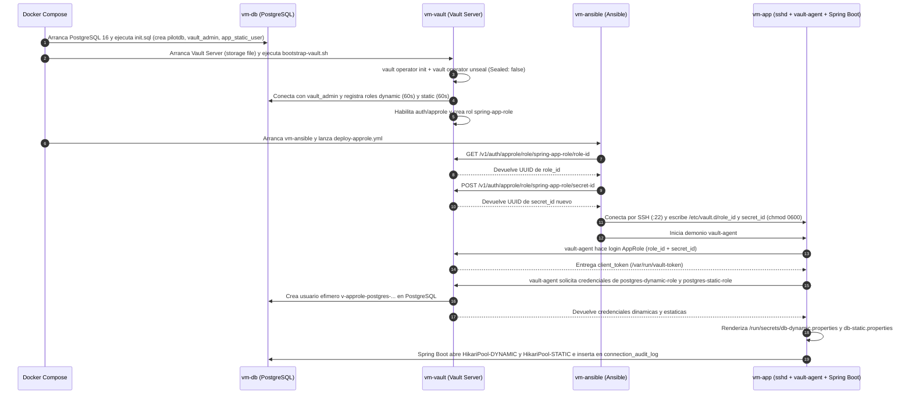
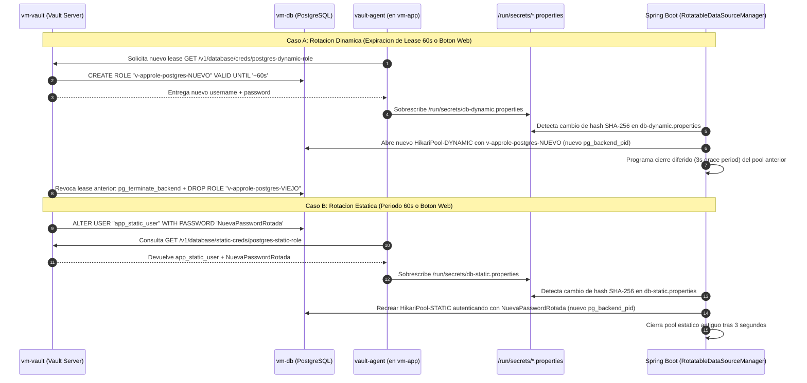
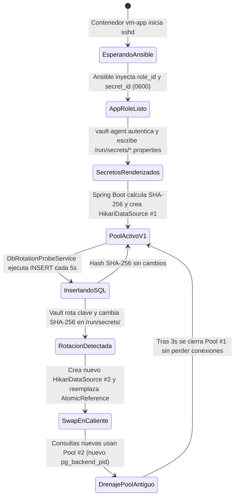

# Manual Completo "Para Dummies" — Piloto HashiCorp Vault + Ansible + Spring Boot + PostgreSQL

Bienvenido a la guía paso a paso desde cero. Este documento está escrito para que **cualquier persona** (aunque nunca haya tocado HashiCorp Vault, Ansible o HikariCP) entienda exactamente **qué problema resuelve este piloto, cómo funciona cada pieza por dentro y cómo operarlo sin ninguna duda**.

> [!IMPORTANT]
> 🛠️ **¿Buscas la lista de comandos 1 por 1 para ir ejecutándolos paso a paso hasta tener todo montado?**
> 👉 **[Abre aquí la Guía de Comandos 1 por 1 (`docs/PASO-A-PASO-COMANDOS.md`)](PASO-A-PASO-COMANDOS.md)** (incluye tanto el **Recorrido A** levantando Docker contenedor a contenedor como el **Recorrido B** con los **22 comandos internos reales** de PostgreSQL, Vault, Ansible y Spring Boot explicados uno por uno).

---

## Índice de Contenidos

1. [¿Qué problema estamos resolviendo? (La analogía del Hotel)](#1-qué-problema-estamos-resolviendo-la-analogía-del-hotel)
2. [Diccionario "Para Dummies": Los 7 conceptos clave](#2-diccionario-para-dummies-los-7-conceptos-clave)
3. [Comparativa Visual: Secreto Dinámico vs. Secreto Estático Rotado](#3-comparativa-visual-secreto-dinámico-vs-secreto-estático-rotado)
4. [Gráficos de Arquitectura y Flujo (Mermaid)](#4-gráficos-de-arquitectura-y-flujo-mermaid)
   - [4.1 Mapa Topológico de las 4 Máquinas Virtuales (Contenedores)](#41-mapa-topológico-de-las-4-máquinas-virtuales-contenedores)
   - [4.2 Secuencia Paso a Paso: Arranque y Negociación Inicial (Ansible + AppRole)](#42-secuencia-paso-a-paso-arranque-y-negociación-inicial-ansible--approle)
   - [4.3 Secuencia Paso a Paso: Rotación en Caliente (Dinámica y Estática)](#43-secuencia-paso-a-paso-rotación-en-caliente-dinámica-y-estática)
   - [4.4 Diagrama de Estados: Ciclo de Vida de Claves y Pool HikariCP](#44-diagrama-de-estados-ciclo-de-vida-de-claves-y-pool-hikaricp)
5. [Puesta en Marcha Paso a Paso (De Cero a Funcionando)](#5-puesta-en-marcha-paso-a-paso-de-cero-a-funcionando)
6. [Guía Visual de la Consola Web Animada (`http://localhost:18080`)](#6-guía-visual-de-la-consola-web-animada-httplocalhost18080)
7. [Recetario de Terminal ("Caja de Cristal"): Comandos para curiosear por dentro](#7-recetario-de-terminal-caja-de-cristal-comandos-para-curiosear-por-dentro)
8. [Preguntas Frecuentes (FAQ) y Resolución de Problemas (Troubleshooting)](#8-preguntas-frecuentes-faq-y-resolución-de-problemas-troubleshooting)

---

## 1. ¿Qué problema estamos resolviendo? (La analogía del Hotel)

### El modo tradicional (Inseguro)
En la mayoría de las empresas, una aplicación Java necesita conectarse a una base de datos PostgreSQL. Lo habitual es escribir el usuario y la contraseña en un fichero de configuración (`application.yml` o variable de entorno):
- Esa contraseña **dura meses o años sin cambiar**.
- Si alguien copia ese fichero o lee el repositorio, tiene acceso total a la base de datos.
- Si decides cambiar la contraseña en PostgreSQL, **la aplicación Java se cae** hasta que alguien actualice el fichero y reinicie la aplicación.

### El modo HashiCorp Vault (Cómo funciona este piloto)
Imagina que la base de datos PostgreSQL es un **Hotel** y HashiCorp Vault es el **Recepcionista Jefe**:
1. **La aplicación Java no conoce ninguna contraseña al nacer.**
2. **Ansible (el mensajero de confianza)** entra por SSH a la máquina de la aplicación y le entrega dos tarjetas de identidad (`role_id` y `secret_id`).
3. En la máquina de la aplicación vive un asistente llamado **Vault Agent**. Este asistente presenta esas dos tarjetas al Recepcionista (**Vault**) y le pide llaves para entrar a la base de datos.
4. **Vault** habla directamente con PostgreSQL y hace dos cosas cada 60 segundos:
   - **Modo Dinámico (Tarjeta de invitado temporal):** Crea un usuario nuevo en PostgreSQL que **se autodestruye a los 60 segundos** (`v-approle-postgres-...`).
   - **Modo Estático Rotado (Cambio de cerradura):** Mantiene el mismo usuario (`app_static_user`), pero **le cambia la contraseña cada 60 segundos**.
5. **Vault Agent** escribe las nuevas claves en dos ficheros dentro de la máquina (`/run/secrets/db-dynamic.properties` y `/run/secrets/db-static.properties`).
6. **Spring Boot** detecta al vuelo que el fichero ha cambiado, **abre conexiones nuevas con la clave recién estrenada y cierra las viejas sin perder ni una sola consulta SQL y sin reiniciarse jamás**.

---

## 2. Diccionario "Para Dummies": Los 7 conceptos clave

| Concepto | ¿Qué es en palabras sencillas? | ¿Dónde vive en este piloto? |
| :--- | :--- | :--- |
| **HashiCorp Vault Server** | La caja fuerte central que guarda secretos y tiene permiso de administrador (`vault_admin`) en PostgreSQL para crear usuarios y cambiar contraseñas. | Contenedor `vm-vault` (`172.29.0.10:8200`) con disco persistente en `/vault/file`. |
| **Init & Unseal (Inicializar y Desellar)** | Cuando Vault arranca por primera vez, su disco está cifrado y bloqueado ("Sealed"). `init` genera la llave maestra y `unseal` abre la caja fuerte para que pueda operar. | Lo ejecuta automáticamente `/usr/local/bin/bootstrap-vault.sh` al arrancar `vm-vault`. |
| **AppRole (`role_id` + `secret_id`)** | Es el "DNI + PIN" para que una máquina se autentique ante Vault sin intervención humana. El `role_id` es como el nombre de usuario de la app y el `secret_id` es el PIN secreto que entrega el orquestador de despliegues. | Rol `spring-app-role` en Vault; ficheros `/etc/vault.d/role_id` y `/etc/vault.d/secret_id` en `vm-app`. |
| **Ansible** | La herramienta de automatización que pide el `role_id` y un `secret_id` nuevo a Vault y los deposita por SSH en la máquina `vm-app` con permisos blindados (`0600`). | Contenedor `vm-ansible` (`172.29.0.40`), playbook `deploy-approle.yml`. |
| **Vault Agent** | Un pequeño programa guardián que corre dentro de `vm-app`. Lee `role_id` y `secret_id`, obtiene un token de Vault, renueva las claves antes de que caduquen y rellena las plantillas `.ctmpl`. | Proceso `vault agent` en `vm-app`, configurado en `/etc/vault.d/vault-agent.hcl`. |
| **Plantillas `.ctmpl`** | Moldes de texto que Vault Agent rellena con el usuario y contraseña reales para producir `/run/secrets/db-dynamic.properties` y `/run/secrets/db-static.properties`. | `/etc/vault.d/templates/*.ctmpl` en `vm-app`. |
| **HikariCP Hot-Reload** | El gestor de conexiones SQL de Spring Boot. Normalmente solo lee la contraseña al arrancar; en este piloto, `RotatableDataSourceManager` vigila el hash SHA-256 del fichero y recrea el pool en caliente cuando cambia la clave. | Clase `RotatableDataSourceManager.java` en `vm-app`. |
| **Gitea Git Server (`vm-git`)** | Un servidor Git con interfaz web propia (como un GitHub privado en miniatura) donde guardamos el fichero `vault-rotation-pilot.yml`. | Contenedor `vm-git` (`172.29.0.50:3000`, accesible desde tu navegador en `http://localhost:13000`). |
| **Spring Cloud Config Server (`vm-config-server`)** | Un microservicio centralizador que combina las propiedades de negocio del repositorio Git de Gitea con los secretos KV v2 de HashiCorp Vault (`secret/data/vault-rotation-pilot`) y se los sirve a `vm-app` para recargarlos en caliente con `@RefreshScope`. | Contenedor `vm-config-server` (`172.29.0.60:8888`, accesible en `http://localhost:18888/vault-rotation-pilot/default`). |

---

## 3. Comparativa Visual: Secreto Dinámico vs. Secreto Estático Rotado

Este piloto prueba **ambos mundos simultáneamente** para que puedas compararlos en vivo:

| Característica | Canal 1: Secreto Dinámico (`DYNAMIC`) | Canal 2: Rol Estático Rotado (`STATIC`) |
| :--- | :--- | :--- |
| **Rol en Vault** | `database/creds/postgres-dynamic-role` | `database/static-creds/postgres-static-role` |
| **¿Qué cambia en cada rotación?** | **Cambia el usuario Y la contraseña** | **El usuario es siempre el mismo; cambia la contraseña** |
| **Nombre de usuario SQL** | Efímero: `v-approle-postgres-XLNZ...-1792434047` | Fijo: `app_static_user` |
| **¿Qué ejecuta Vault en PostgreSQL?** | `CREATE ROLE "v-approle-..." WITH LOGIN PASSWORD '...'` y al caducar: `DROP ROLE` | `ALTER USER "app_static_user" WITH PASSWORD '...'` |
| **Tiempo de vida (TTL / Periodo)** | `60 segundos` (configurable) | `60 segundos` (o rotación manual inmediata) |
| **¿Cuándo usarlo en la vida real?** | Microservicios modernos: trazabilidad total por instancia (si se filtra una clave, sabes de qué contenedor salió y muere sola en minutos). | Aplicaciones legacy o esquemas que exigen un nombre de usuario fijo en base de datos pero requieren rotar su password periódicamente. |

---

## 4. Gráficos de Arquitectura y Flujo (Mermaid)

### 4.1 Mapa Topológico de las 6 Máquinas Virtuales (Contenedores)

```mermaid
flowchart LR
    subgraph NET["Red Bridge Docker: vault-pilot-net (172.29.0.0/24)"]
        direction LR

        subgraph ANS["vm-ansible (172.29.0.40)"]
            A1["Playbook: deploy-approle.yml"]
            A2["Inventario SSH: vm-config-server + vm-app"]
        end

        subgraph VLT["vm-vault (172.29.0.10:8200)"]
            V1["Almacenamiento en Disco (/vault/file)"]
            V2["Auth Method: auth/approle/spring-app-role"]
            V3["Database Engine: dynamic & static (60s)"]
            V5["KV v2 (secret/): git-credentials & vault-rotation-pilot"]
        end

        subgraph GIT["vm-git (172.29.0.50:3000 - Host :13000)"]
            G1["Gitea Git Server + SQLite3"]
            G2["Repo: pilot-admin/pilot-config (vault-rotation-pilot.yml)"]
            G1 --> G2
        end

        subgraph CFG["vm-config-server (172.29.0.60:8888 - Host :18888)"]
            CS_AG["vault-agent (lee secret/git-credentials)"]
            CS_APP["Spring Cloud Config Server (Composite: git + vault)"]
            CS_AG --> CS_APP
        end

        subgraph APP["vm-app (172.29.0.30) - Puerto Host 18080:8080"]
            SSH["Demonio OpenSSH (:22)"]
            CRED["/etc/vault.d/role_id + secret_id (0600)"]
            AG["Demonio vault-agent (Auto-Auth + Render 10s)"]
            FILES["/run/secrets/db-dynamic & db-static.properties"]
            SB["Spring Boot 3 + @RefreshScope + RotatableDataSourceManager"]
            POOL_D["HikariPool-DYNAMIC"]
            POOL_S["HikariPool-STATIC"]

            SSH --> CRED --> AG --> FILES --> SB
            SB --> POOL_D
            SB --> POOL_S
        end

        subgraph DB["vm-db (172.29.0.20:5432)"]
            PG["PostgreSQL 16 (BBDD: pilotdb)"]
            T_AUD["Tabla: public.connection_audit_log"]
            PG --> T_AUD
        end

        A1 -- "1. Pide role_id y genera secret_id" --> V2
        A1 -- "2a. Inyecta AppRole por SSH" --> CFG
        A1 -- "2b. Inyecta AppRole por SSH" --> SSH
        CS_APP -- "3a. Clona YAML de Gitea" --> G2
        CS_APP -- "3b. Lee KV v2 secret/vault-rotation-pilot" --> V5
        SB -- "4. Importa config y @RefreshScope" --> CS_APP
        AG -- "5. Login AppRole y lectura de leases" --> V2
        V3 -- "6. CREATE ROLE / ALTER USER" --> PG
        POOL_D -- "7a. INSERT cada 5s (Dynamic)" --> PG
        POOL_S -- "7b. INSERT cada 5s (Static)" --> PG
    end
```



---

### 4.2 Secuencia Paso a Paso: Arranque y Negociación Inicial (Ansible + AppRole)



---

### 4.3 Secuencia Paso a Paso: Rotación en Caliente (Dinámica y Estática)



---

### 4.4 Diagrama de Estados: Ciclo de Vida de Claves y Pool HikariCP



---

## 5. Puesta en Marcha Paso a Paso (De Cero a Funcionando)

> 💡 **¿Quieres ejecutar los comandos 1 por 1 en lugar de lanzarlo todo de golpe?**
> Ve a **[`docs/PASO-A-PASO-COMANDOS.md`](PASO-A-PASO-COMANDOS.md)** para seguir las fichas numeradas comando a comando (12 pasos con Docker o los 22 comandos internos destripados).

### Paso 5.1 — Requisitos previos
Solo necesitas tener instalado en tu ordenador:
1. **Docker Desktop** (en Windows/macOS) o **Docker Engine + Docker Compose** (en Linux).
2. **Git** (en Windows incluye **Git Bash**, muy útil para lanzar los scripts `.sh`).

Comprueba que Docker está encendido ejecutando en tu terminal:
```bash
docker info
```

### Paso 5.2 — Clonar el repositorio y entrar en la carpeta
```bash
git clone https://github.com/aremox/vault.git
cd vault
```

### Paso 5.3 — Arrancar las 4 máquinas virtuales (Contenedores)
Ejecuta un único comando:
```bash
docker compose up -d --build
```

**¿Qué ocurre exactamente durante los primeros 30 segundos tras este comando?**
1. Se crea la red privada `vault-pilot-net` con el rango IP `172.29.0.0/24`.
2. Arranca **`vm-db` (`172.29.0.20`)**: PostgreSQL 16 ejecuta automáticamente `infra/db/init.sql`, creando la base de datos `pilotdb`, la tabla `public.connection_audit_log`, el superusuario `vault_admin` y el usuario fijo `app_static_user`.
3. Arranca **`vm-vault` (`172.29.0.10`)**: ejecuta `infra/vault/scripts/bootstrap-vault.sh`, que inicializa Vault en disco (`/vault/file`), lo desella (`Sealed: false`), lo conecta a PostgreSQL, crea los roles `postgres-dynamic-role` y `postgres-static-role` y configura `auth/approle/role/spring-app-role`.
4. Arranca **`vm-app` (`172.29.0.30`)**: enciende su servidor SSH (`sshd`) y queda esperando a que Ansible le entregue sus credenciales AppRole.
5. Arranca **`vm-ansible` (`172.29.0.40`)**: ejecuta el playbook `deploy-approle.yml`, pide el `role_id` y un `secret_id` nuevo a Vault, se conecta por SSH a `vm-app`, guarda `/etc/vault.d/role_id` y `/etc/vault.d/secret_id` con permisos `0600` y arranca `vault-agent`.
6. **`vault-agent`** escribe `/run/secrets/db-dynamic.properties` y `/run/secrets/db-static.properties`, y **Spring Boot** arranca en el puerto `8080` (mapeado al `18080` de tu PC).

### Paso 5.4 — Comprobar que los 4 contenedores están sanos (`Healthy`)
```bash
docker compose ps
```
Deberías ver los 4 contenedores (`vm-db`, `vm-vault`, `vm-app`, `vm-ansible`) en estado `Up (healthy)`.

---

## 6. Guía Visual de la Consola Web Animada (`http://localhost:18080`)

Abre tu navegador favorito y entra en:
> **http://localhost:18080**

### ¿Qué estás viendo en pantalla?

1. **Mapa Topológico Animado (Parte superior):**
   - Muestra las 4 máquinas en la subred `172.29.0.0/24`.
   - **Bolitas moradas (`Ansible SSH`):** representan el envío de `role_id` y `secret_id` hacia `vm-app`.
   - **Bolitas ámbar (`Vault API / DDL SQL`):** representan a `vault-agent` renovando tokens y a `vm-vault` creando usuarios o rotando contraseñas en PostgreSQL.
   - **Bolitas cian (`SQL DYN`):** representan las consultas SQL que Spring Boot hace cada 5 segundos usando el **usuario efímero dinámico**.
   - **Bolitas verdes (`SQL STAT`):** representan las consultas SQL que Spring Boot hace cada 5 segundos usando el **usuario fijo con contraseña rotada**.

2. **Las 4 Tarjetas Centrales de Secretos y Configuración:**
   - **Tarjeta Morada (`Artefactos AppRole /etc/vault.d`):** muestra el `role_id`, los permisos `0600` y el `secret_id` oculto. Pulsa el botón **`Mostrar`** para ver el UUID real inyectado por Ansible.
   - **Tarjeta Cian (`DYNAMIC LEASE · TTL 60s`):**
     - Observa el campo **Usuario Efímero Actual** (`v-approle-postgres-...`).
     - Cada 60 segundos (o cuando pulses el botón superior **`⚡ Forzar Rotación Dinámica`**), la tarjeta **brillará**, el usuario actual pasará a "Usuario Efímero Anterior", aparecerá un usuario completamente nuevo, cambiará el hash SHA-256 y cambiará el `PID` de PostgreSQL.
     - Pulsa **`Mostrar`** junto a `Password SQL Negociada` para ver la contraseña real generada por Vault.
   - **Tarjeta Verde (`STATIC ROLE · ROTACIÓN 60s`):**
     - Aquí el usuario **siempre es `app_static_user`**.
     - Pulsa **`Mostrar`** en la contraseña y luego haz clic arriba en **`🔑 Forzar Rotación Estática`**.
     - Verás en directo cómo la contraseña cambia de texto, cambia su hash SHA-256 y **cambia el `PID` de conexión en PostgreSQL** (demostrando que Spring Boot cerró el pool viejo y abrió uno nuevo con la nueva contraseña).
   - **Tarjeta Rosa (`GITEA + SPRING CLOUD CONFIG`):**
     - Muestra el repositorio `pilot-admin/pilot-config` (con enlace directo a `http://localhost:13000`), el SHA del último commit en Gitea, el `pilot.config.banner` y el secreto `pilot.vault.kv.secret-signature` traído de Vault KV v2 a través de `vm-config-server` (`http://localhost:18888`).
     - Al pulsar el botón **`🔄 Commit en Gitea + Refresh Spring Cloud (@RefreshScope)`** (o `Commit + Refresh` en la tarjeta), `vm-app` hace un nuevo commit automático en Gitea, rota el secreto en Vault KV v2 e invoca `ContextRefresher.refresh()` para recargar `@RefreshScope` en vivo sin reiniciar el contenedor.

3. **Botón `▶ Simular Flujo Completo` (Arriba a la derecha):**
   - Si quieres enseñar a alguien cómo funciona la arquitectura paso a paso, pulsa este botón: la web iluminará secuencialmente los pasos `1/5` a `5/5` lanzando ráfagas de paquetes entre los nodos.

4. **Tablas Inferiores en Vivo:**
   - **Izquierda (`pg_stat_activity`):** sesiones abiertas realmente ahora mismo dentro de PostgreSQL.
   - **Derecha (`public.connection_audit_log`):** cada 5 segundos aparecen dos filas nuevas (`DYNAMIC` y `STATIC`) probando que no se pierde ni una sola consulta durante las rotaciones.

---

## 7. Recetario de Terminal ("Caja de Cristal"): Comandos para curiosear por dentro

Si no te fías solo de la web y quieres comprobarlo tú mismo desde la terminal, aquí tienes todos los comandos listos para copiar y pegar:

### 7.1 Ejecutar los scripts de auditoría automática
En Linux/macOS o Git Bash en Windows:
```bash
# Prueba completa de infraestructura, Ansible, Vault y rotacion (tarda ~65s esperando el TTL)
bash scripts/verify-pilot.sh

# Prueba rapida de la consola web y rotacion forzada por API (tarda ~5s)
bash scripts/verify-ui.sh
```

### 7.2 Inspeccionar el servidor HashiCorp Vault (`vm-vault`)
```bash
# Ver que Vault esta inicializado, desellado (Sealed: false) y usa disco (file)
docker exec vm-vault vault status

# Leer una credencial estatica directamente desde Vault
ROOT_TOKEN=$(docker exec vm-vault cat /vault/bootstrap/root.token)
docker exec -e VAULT_TOKEN="$ROOT_TOKEN" vm-vault vault read database/static-creds/postgres-static-role
```

### 7.3 Inspeccionar los ficheros secretos dentro de la máquina de aplicación (`vm-app`)
```bash
# Ver permisos (0600) y contenido del role_id y secret_id depositados por Ansible
docker exec vm-app ls -la /etc/vault.d/
docker exec vm-app cat /etc/vault.d/role_id

# Ver las credenciales en claro que Vault Agent ha escrito para Spring Boot
docker exec vm-app cat /run/secrets/db-dynamic.properties
docker exec vm-app cat /run/secrets/db-static.properties
```

### 7.4 Ver los logs de Spring Boot recargando HikariCP en vivo
```bash
docker logs -f --tail 30 vm-app
```
Verás líneas como:
```text
[ROTATION-DETECTED] Modo=DYNAMIC | Usuario=v-approle-postgres-... | Rotacion=#2 -> Recreando pool HikariCP...
[POOL-EVICT] Cerrando pool HikariCP anterior para modo DYNAMIC
[PROBE-OK] modo=DYNAMIC | audit_id=42 | db_user=v-approle-postgres-... | pg_pid=487
```

### 7.5 Consultar la base de datos PostgreSQL directamente (`vm-db`)
```bash
# Ver los usuarios efimeros creados actualmente en el catalogo de PostgreSQL
docker exec vm-db psql -U postgres -d pilotdb -c "\du"

# Ver el resumen de rotaciones registradas en la tabla de auditoria
docker exec vm-db psql -U postgres -d pilotdb -c "
SELECT credential_mode, db_username, backend_pid, COUNT(*) AS consultas,
       MIN(executed_at) AS primera_vez, MAX(executed_at) AS ultima_vez
FROM public.connection_audit_log
GROUP BY credential_mode, db_username, backend_pid
ORDER BY MIN(id);
"
```

### 7.6 Relanzar manualmente el playbook de Ansible (`vm-ansible`)
```bash
docker exec vm-ansible ansible-playbook -i /etc/ansible/inventory.ini /etc/ansible/playbooks/deploy-approle.yml
```

### 7.7 Apagar o reiniciar el laboratorio desde cero
```bash
# Apagar conservando los datos en disco
docker compose down

# Apagar y borrar todos los volumenes para empezar completamente limpio
docker compose down -v
```

---

## 8. Preguntas Frecuentes (FAQ) y Resolución de Problemas (Troubleshooting)

| Síntoma o Duda | Causa Probable | Solución Exacta |
| :--- | :--- | :--- |
| **Error `Pool overlaps with other one on this address space` al hacer `docker compose up`** | Tienes otra red Docker antigua ocupando el rango `172.29.0.0/24`. | Ejecuta `docker network ls` para ver redes activas o elimina redes huérfanas con `docker network prune`. |
| **Error `Ports are not available: bind 0.0.0.0:18080` (o `15432`, `18200`)** | Otro programa en tu PC está usando ese puerto. | Cambia el puerto izquierdo en `docker-compose.yml` (por ejemplo `"28080:8080"`). La red interna entre contenedores (`172.29.0.x`) seguirá funcionando igual. |
| **En Windows Git Bash me sale `C:/Program Files/Git/etc/ansible/... could not be found`** | Git Bash convierte automáticamente las rutas que empiezan por `/` a rutas de Windows. | Precede tu comando con `MSYS_NO_PATHCONV=1`, por ejemplo: `MSYS_NO_PATHCONV=1 docker exec vm-app cat /etc/vault.d/role_id`. Los scripts `verify-pilot.sh` y `verify-ui.sh` ya lo llevan incluido. |
| **¿Por qué Spring Boot necesita `RotatableDataSourceManager` si ya existe `vault-agent`?** | Porque `vault-agent` actualiza el fichero en disco (`/run/secrets/db-static.properties`), pero un pool de conexiones SQL tradicional (`HikariCP`) mantiene abiertas las conexiones TCP ya establecidas con la contraseña vieja. | `RotatableDataSourceManager` calcula el hash SHA-256 del fichero; cuando cambia, crea un pool nuevo con la nueva clave y cierra el antiguo tras 3 segundos de gracia. |
| **¿Qué pasa si reinicio el contenedor `vm-vault`?** | Como usa almacenamiento en disco (`file` en `/vault/file`), **no pierde su configuración**, y el script `bootstrap-vault.sh` detecta que ya está inicializado y lo desella automáticamente con `/vault/bootstrap/unseal.key`. | Puedes probarlo ejecutando `docker restart vm-vault`. |
