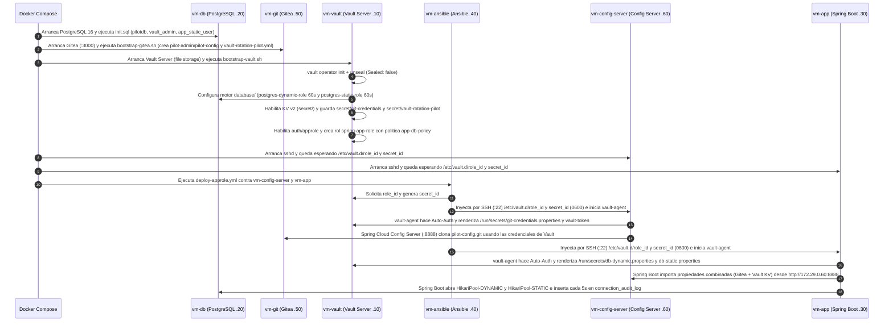
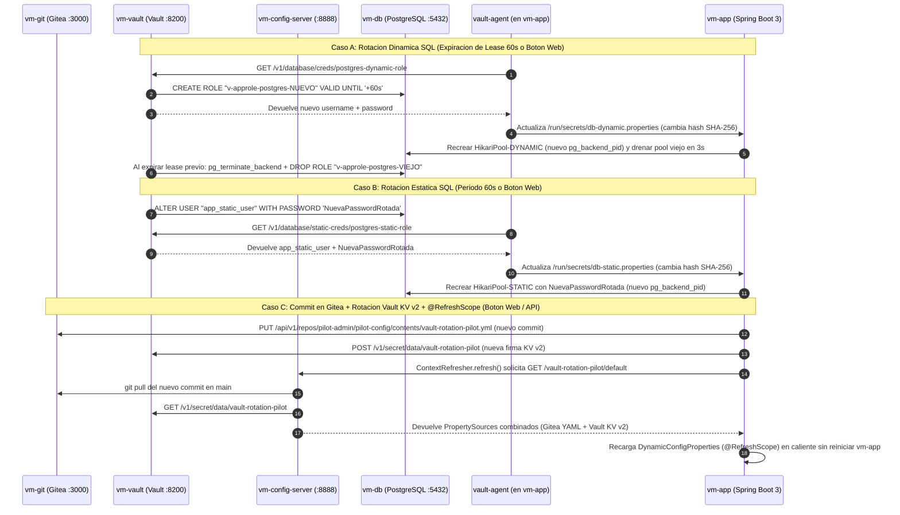
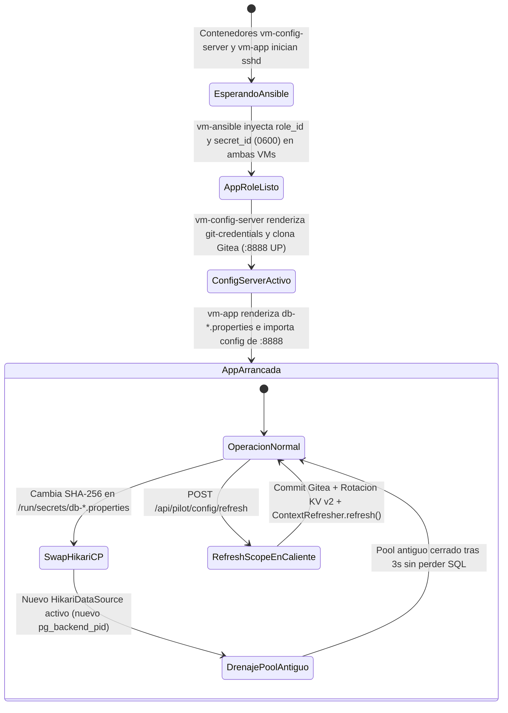

# Manual Completo "Para Dummies" — Piloto HashiCorp Vault + Gitea + Spring Cloud Config + Ansible + Spring Boot + PostgreSQL

Bienvenido a la guía paso a paso desde cero. Este documento está escrito para que **cualquier persona** (aunque nunca haya tocado HashiCorp Vault, Gitea, Spring Cloud Config, Ansible o HikariCP) entienda exactamente **qué problema resuelve este piloto de 6 máquinas virtuales, cómo funciona cada pieza por dentro y cómo operarlo sin ninguna duda**.

> [!IMPORTANT]
> 🛠️ **¿Buscas la lista de comandos 1 por 1 para ir ejecutándolos paso a paso hasta tener todo montado?**
> 👉 **[Abre aquí la Guía de Comandos 1 por 1 (`docs/PASO-A-PASO-COMANDOS.md`)](PASO-A-PASO-COMANDOS.md)** (incluye tanto el **Recorrido A** levantando las 6 máquinas Docker contenedor a contenedor en **16 pasos** como el **Recorrido B** con los **28 comandos internos reales** de PostgreSQL, Gitea, Vault, Ansible, Spring Cloud Config y Spring Boot explicados uno por uno en orden cronológico).

---

## Índice de Contenidos

1. [¿Qué problema estamos resolviendo? (La analogía del Hotel)](#1-qué-problema-estamos-resolviendo-la-analogía-del-hotel)
2. [Diccionario "Para Dummies": Los 9 conceptos clave](#2-diccionario-para-dummies-los-9-conceptos-clave)
3. [Comparativa Visual: Los 3 Canales de Recarga en Caliente del Piloto](#3-comparativa-visual-los-3-canales-de-recarga-en-caliente-del-piloto)
4. [Gráficos de Arquitectura y Flujo (Mermaid)](#4-gráficos-de-arquitectura-y-flujo-mermaid)
   - [4.1 Mapa Topológico de las 6 Máquinas Virtuales (Contenedores)](#41-mapa-topológico-de-las-6-máquinas-virtuales-contenedores)
   - [4.2 Secuencia Paso a Paso: Arranque y Negociación Inicial de las 6 VMs](#42-secuencia-paso-a-paso-arranque-y-negociación-inicial-de-las-6-vms)
   - [4.3 Secuencia Paso a Paso: Rotación SQL (Dinámica y Estática) y Hot-Reload `@RefreshScope`](#43-secuencia-paso-a-paso-rotación-sql-dinámica-y-estática-y-hot-reload-refreshscope)
   - [4.4 Diagrama de Estados: Ciclo de Vida de Claves HikariCP y Beans `@RefreshScope`](#44-diagrama-de-estados-ciclo-de-vida-de-claves-hikaricp-y-beans-refreshscope)
5. [Puesta en Marcha Paso a Paso (De Cero a las 6 VMs Funcionando)](#5-puesta-en-marcha-paso-a-paso-de-cero-a-las-6-vms-funcionando)
6. [Guía Visual de la Consola Web Animada (`http://localhost:18080`)](#6-guía-visual-de-la-consola-web-animada-httplocalhost18080)
7. [Recetario de Terminal ("Caja de Cristal"): Comandos para curiosear por dentro](#7-recetario-de-terminal-caja-de-cristal-comandos-para-curiosear-por-dentro)
8. [Preguntas Frecuentes (FAQ) y Resolución de Problemas (Troubleshooting)](#8-preguntas-frecuentes-faq-y-resolución-de-problemas-troubleshooting)

---

## 1. ¿Qué problema estamos resolviendo? (La analogía del Hotel)

### El modo tradicional (Inseguro y Rígido)
En la mayoría de las empresas, una aplicación Java necesita conectarse a una base de datos PostgreSQL y leer parámetros de configuración. Lo habitual es escribir usuarios, contraseñas y propiedades en un fichero local (`application.yml` o variables de entorno):
- Esas contraseñas **duran meses o años sin cambiar**.
- Si alguien copia ese fichero o lee el repositorio, tiene acceso total a la base de datos y a las claves del servidor Git.
- Si decides cambiar una contraseña en PostgreSQL o modificar un parámetro en Git, **la aplicación Java se cae o obliga a reiniciar el servidor**.

### El modo Zero-Trust con HashiCorp Vault + Gitea + Spring Cloud Config (Cómo funciona este piloto)
Imagina que la base de datos PostgreSQL es un **Hotel de Alta Seguridad**, HashiCorp Vault es el **Recepcionista Jefe con la Caja Fuerte**, Gitea es el **Libro Oficial de Normas del Hotel** y Spring Cloud Config Server es el **Tablón Central de Anuncios**:

1. **Ni la aplicación Java (`vm-app`) ni el servidor de configuración (`vm-config-server`) conocen ninguna contraseña al nacer.**
2. **Ansible (`vm-ansible`, el mensajero de confianza)** entra por SSH a ambas máquinas (`vm-config-server` y `vm-app`) y les entrega en mano dos tarjetas de identidad (`role_id` y `secret_id`) con permisos blindados (`0600`).
3. En cada una de esas máquinas vive un asistente llamado **Vault Agent**:
   - En **`vm-config-server`**, el asistente presenta su tarjeta a **Vault** y descarga el usuario/contraseña de **Gitea (`vm-git`)** desde `secret/data/git-credentials`. Así, `vm-config-server` puede clonar el repositorio `pilot-admin/pilot-config.git` y combinar sus ficheros YAML con los secretos KV v2 de Vault (`secret/data/vault-rotation-pilot`).
   - En **`vm-app`**, el asistente presenta su tarjeta a **Vault** y le pide llaves para entrar a la base de datos PostgreSQL (`vm-db`).
4. **Vault (`vm-vault`)** habla directamente con PostgreSQL y hace dos cosas cada 60 segundos:
   - **Modo Dinámico (Tarjeta de invitado temporal):** Crea un usuario nuevo en PostgreSQL que **se autodestruye a los 60 segundos** (`v-approle-postgres-...`).
   - **Modo Estático Rotado (Cambio de cerradura):** Mantiene el mismo usuario (`app_static_user`), pero **le cambia la contraseña cada 60 segundos**.
5. **Spring Boot (`vm-app`) opera 100% en caliente sin reiniciarse jamás**:
   - Cuando `vault-agent` escribe nuevas claves SQL en `/run/secrets/db-dynamic.properties` o `db-static.properties`, `RotatableDataSourceManager` abre un pool HikariCP nuevo con la clave recién estrenada y cierra el viejo sin perder ni una sola consulta SQL.
   - Cuando alguien hace un commit en **Gitea (`vm-git`)** y rota un secreto KV en **Vault**, `vm-app` consulta a **`vm-config-server`** y recarga sus beans `@RefreshScope` al vuelo en milisegundos.

---

## 2. Diccionario "Para Dummies": Los 9 conceptos clave

| Concepto | ¿Qué es en palabras sencillas? | ¿Dónde vive en este piloto? |
| :--- | :--- | :--- |
| **HashiCorp Vault Server** | La caja fuerte central que guarda secretos KV v2 y tiene permiso de administrador (`vault_admin`) en PostgreSQL para crear usuarios y cambiar contraseñas. | Contenedor `vm-vault` (`172.29.0.10:8200`, Host `http://localhost:18200`) con disco en `/vault/file`. |
| **Init & Unseal (Inicializar y Desellar)** | Cuando Vault arranca por primera vez, su disco está cifrado y bloqueado ("Sealed"). `init` genera la llave maestra y `unseal` abre la caja fuerte para que pueda operar. | Lo ejecuta automáticamente `/usr/local/bin/bootstrap-vault.sh` al arrancar `vm-vault`. |
| **AppRole (`role_id` + `secret_id`)** | Es el "DNI + PIN" para que una máquina se autentique ante Vault sin intervención humana. El `role_id` identifica el rol y el `secret_id` es el PIN único que entrega Ansible. | Rol `spring-app-role` en Vault; ficheros `/etc/vault.d/role_id` y `/etc/vault.d/secret_id` en `vm-config-server` y `vm-app`. |
| **Ansible** | La herramienta de automatización que pide el `role_id` y genera un `secret_id` único para cada máquina en Vault, depositándolos por SSH con permisos blindados (`0600`). | Contenedor `vm-ansible` (`172.29.0.40`), inventario `inventory.ini` y playbook `deploy-approle.yml`. |
| **Vault Agent** | Un pequeño programa guardián que corre dentro de `vm-config-server` y `vm-app`. Lee `role_id` y `secret_id`, obtiene y renueva el token de Vault y rellena las plantillas `.ctmpl`. | Proceso `vault agent` en `vm-config-server` y `vm-app`, configurado en `/etc/vault.d/vault-agent.hcl`. |
| **Plantillas `.ctmpl` y Motor KV v2 (`secret/`)** | Moldes que Vault Agent rellena con secretos reales: en `vm-config-server` produce `/run/secrets/git-credentials.properties` (leído del motor KV v2 `secret/git-credentials`) y en `vm-app` produce `/run/secrets/db-dynamic.properties` y `db-static.properties`. | `/etc/vault.d/templates/*.ctmpl` en `vm-config-server` y `vm-app`. |
| **Gitea Git Server (`vm-git`)** | Un servidor Git ligero con interfaz web propia (como un GitHub privado) donde vive el repositorio `pilot-admin/pilot-config` con el fichero `vault-rotation-pilot.yml`. | Contenedor `vm-git` (`172.29.0.50:3000`, accesible en `http://localhost:13000`). |
| **Spring Cloud Config Server (`vm-config-server`)** | Microservicio centralizador con **Composite Backend (`git` + `vault`)**: une las propiedades del YAML de Gitea con los secretos KV v2 de Vault (`secret/data/vault-rotation-pilot`) y se los sirve a `vm-app`. | Contenedor `vm-config-server` (`172.29.0.60:8888`, accesible en `http://localhost:18888/vault-rotation-pilot/default`). |
| **HikariCP Hot-Reload + `@RefreshScope`** | Los dos mecanismos de recarga sin reinicio en `vm-app`: `RotatableDataSourceManager` recrea los pools SQL cuando cambia el hash SHA-256 en `/run/secrets/`, y `@RefreshScope` (`ContextRefresher.refresh()`) actualiza en vivo las propiedades cuando hay un commit en Gitea o cambio en Vault KV v2. | Clases `RotatableDataSourceManager.java`, `DynamicConfigProperties.java` y `SpringCloudConfigService.java` en `vm-app`. |

---

## 3. Comparativa Visual: Los 3 Canales de Recarga en Caliente del Piloto

Este piloto prueba **tres mecanismos de actualización en caliente simultáneamente** para que puedas compararlos en vivo desde la consola web:

| Característica | Canal 1: Secreto Dinámico SQL (`DYNAMIC`) | Canal 2: Rol Estático Rotado SQL (`STATIC`) | Canal 3: Config Centralizada (`GITEA + VAULT KV v2`) |
| :--- | :--- | :--- | :--- |
| **Origen del dato** | `database/creds/postgres-dynamic-role` (Vault -> PostgreSQL) | `database/static-creds/postgres-static-role` (Vault -> PostgreSQL) | `pilot-config.git` (`vm-git`) + `secret/data/vault-rotation-pilot` (`vm-vault`) vía `vm-config-server` |
| **¿Qué cambia en cada rotación/refresh?** | **Cambia el usuario SQL Y la contraseña** | **El usuario SQL es siempre `app_static_user`; cambia la contraseña** | **Cambia el commit/YAML en Gitea (`custom-tag`, `banner`) Y el secreto KV en Vault (`secret-signature`)** |
| **¿Cómo llega a `vm-app`?** | `vault-agent` escribe `/run/secrets/db-dynamic.properties` | `vault-agent` escribe `/run/secrets/db-static.properties` | `vm-app` consulta `http://172.29.0.60:8888` al invocar `ContextRefresher.refresh()` |
| **Mecanismo en Java Spring Boot** | Recreación en caliente de `HikariPool-DYNAMIC` y drenaje del pool previo (3s) | Recreación en caliente de `HikariPool-STATIC` y drenaje del pool previo (3s) | Recarga de beans anotados con `@RefreshScope` (`DynamicConfigProperties`) |
| **Frecuencia / Disparo** | Automática cada `60s` (TTL) o botón **`⚡ Forzar Rotación Dinámica`** | Automática cada `60s` o botón **`🔑 Forzar Rotación Estática`** | Bajo demanda con el botón **`🔄 Commit en Gitea + Refresh Spring Cloud (@RefreshScope)`** |

---

## 4. Gráficos de Arquitectura y Flujo (Mermaid)

### 4.1 Mapa Topológico de las 6 Máquinas Virtuales (Contenedores)

```mermaid
flowchart LR
    subgraph NET["Red Bridge Docker: vault-pilot-net (172.29.0.0/24)"]
        direction LR

        subgraph ANS["vm-ansible (172.29.0.40)"]
            A1["Playbook: deploy-approle.yml"]
            A2["Inventario SSH: vm-config-server + vm-app"]
        end

        subgraph VLT["vm-vault (172.29.0.10:8200 - Host :18200)"]
            V1["Almacenamiento en Disco (/vault/file)"]
            V2["Auth Method: auth/approle/spring-app-role"]
            V3["Database Engine: dynamic & static (60s)"]
            V5["KV v2 (secret/): git-credentials & vault-rotation-pilot"]
        end

        subgraph GIT["vm-git (172.29.0.50:3000 - Host :13000)"]
            G1["Gitea Git Server + SQLite3"]
            G2["Repo: pilot-admin/pilot-config (vault-rotation-pilot.yml)"]
            G1 --> G2
        end

        subgraph CFG["vm-config-server (172.29.0.60:8888 - Host :18888)"]
            CS_SSH["Demonio OpenSSH (:22) + /etc/vault.d"]
            CS_AG["vault-agent (renderiza git-credentials.properties)"]
            CS_APP["Spring Cloud Config Server (Composite: git + vault)"]
            CS_SSH --> CS_AG --> CS_APP
        end

        subgraph APP["vm-app (172.29.0.30:8080 - Host :18080)"]
            SSH["Demonio OpenSSH (:22)"]
            CRED["/etc/vault.d/role_id + secret_id (0600)"]
            AG["Demonio vault-agent (Auto-Auth + Render 10s)"]
            FILES["/run/secrets/db-dynamic & db-static.properties"]
            SB["Spring Boot 3 + @RefreshScope + RotatableDataSourceManager"]
            POOL_D["HikariPool-DYNAMIC"]
            POOL_S["HikariPool-STATIC"]

            SSH --> CRED --> AG --> FILES --> SB
            SB --> POOL_D
            SB --> POOL_S
        end

        subgraph DB["vm-db (172.29.0.20:5432 - Host :15432)"]
            PG["PostgreSQL 16 (BBDD: pilotdb)"]
            T_AUD["Tabla: public.connection_audit_log"]
            PG --> T_AUD
        end

        A1 -- "1. Pide role_id y genera secret_id" --> V2
        A1 -- "2a. Inyecta AppRole por SSH (:22)" --> CS_SSH
        A1 -- "2b. Inyecta AppRole por SSH (:22)" --> SSH
        CS_AG -- "3a. Lee secret/git-credentials" --> V5
        CS_APP -- "3b. Clona YAML de Gitea (:3000)" --> G2
        CS_APP -- "3c. Lee KV v2 secret/vault-rotation-pilot" --> V5
        SB -- "4. Importa config (:8888) y @RefreshScope" --> CS_APP
        AG -- "5. Login AppRole y lectura de leases SQL" --> V2
        V3 -- "6. CREATE ROLE / ALTER USER" --> PG
        POOL_D -- "7a. INSERT cada 5s (Dynamic)" --> PG
        POOL_S -- "7b. INSERT cada 5s (Static)" --> PG
    end
```



---

### 4.2 Secuencia Paso a Paso: Arranque y Negociación Inicial de las 6 VMs



---

### 4.3 Secuencia Paso a Paso: Rotación SQL (Dinámica y Estática) y Hot-Reload `@RefreshScope`



---

### 4.4 Diagrama de Estados: Ciclo de Vida de Claves HikariCP y Beans `@RefreshScope`



---

## 5. Puesta en Marcha Paso a Paso (De Cero a las 6 VMs Funcionando)

> 💡 **¿Quieres ejecutar los comandos 1 por 1 en lugar de lanzarlo todo de golpe?**
> Ve a **[`docs/PASO-A-PASO-COMANDOS.md`](PASO-A-PASO-COMANDOS.md)** para seguir las fichas numeradas comando a comando (**16 pasos con Docker** en el Recorrido A o los **28 comandos internos destripados** en el Recorrido B).

### Paso 5.1 — Requisitos previos
Solo necesitas tener instalado en tu ordenador:
1. **Docker Desktop** (en Windows/macOS) o **Docker Engine + Docker Compose** (en Linux).
2. **Git** (en Windows incluye **Git Bash**, muy útil para lanzar los scripts `.sh`).

Comprueba que Docker está encendido ejecutando en tu terminal:
```bash
docker info
```

### Paso 5.2 — Clonar el repositorio y entrar en la carpeta
```bash
git clone https://github.com/aremox/vault.git
cd vault
```

### Paso 5.3 — Arrancar las 6 máquinas virtuales (Contenedores)
Ejecuta un único comando:
```bash
docker compose up -d --build
```

**¿Qué ocurre exactamente durante los primeros segundos tras este comando?**
1. Se crea la red privada `vault-pilot-net` con el rango IP `172.29.0.0/24`.
2. Arranca **`vm-db` (`172.29.0.20`)**: PostgreSQL 16 ejecuta automáticamente `infra/db/init.sql`, creando la base de datos `pilotdb`, la tabla `public.connection_audit_log`, el superusuario `vault_admin` y el usuario fijo `app_static_user`.
3. Arranca **`vm-git` (`172.29.0.50`)**: ejecuta `infra/git/bootstrap-gitea.sh`, levanta el servidor Git **Gitea** con SQLite3 en el puerto `3000` (Host `13000`), crea el usuario `pilot-admin` y el repositorio `pilot-admin/pilot-config` con el commit inicial de `vault-rotation-pilot.yml`.
4. Arranca **`vm-vault` (`172.29.0.10`)**: ejecuta `infra/vault/scripts/bootstrap-vault.sh`, que inicializa Vault en disco (`/vault/file`), lo desella (`Sealed: false`), configura los roles SQL (`postgres-dynamic-role` y `postgres-static-role`), activa el motor **KV v2 (`secret/`)** guardando `secret/git-credentials` y `secret/vault-rotation-pilot`, y crea el AppRole `spring-app-role`.
5. Arrancan **`vm-config-server` (`172.29.0.60`)** y **`vm-app` (`172.29.0.30`)**: encienden sus servidores SSH (`sshd`) y esperan a que Ansible les entregue sus credenciales AppRole.
6. Arranca **`vm-ansible` (`172.29.0.40`)**: ejecuta `deploy-approle.yml`, pide el `role_id` y genera un `secret_id` para cada máquina, los inyecta por SSH en `/etc/vault.d/` con permisos `0600` y arranca `vault-agent` tanto en `vm-config-server` como en `vm-app`.
7. **`vm-config-server`** arranca en `:8888` (Host `:18888`) sirviendo las propiedades de Gitea + Vault KV v2, y **`vm-app`** arranca en `:8080` (Host `:18080`) consumiendo esa configuración y abriendo los dos pools HikariCP contra PostgreSQL.

### Paso 5.4 — Comprobar que los 6 contenedores están sanos (`Healthy`)
```bash
docker compose ps
```
Deberías ver los 6 contenedores (`vm-db`, `vm-vault`, `vm-git`, `vm-config-server`, `vm-app`, `vm-ansible`) en estado `Up (healthy)`.

---

## 6. Guía Visual de la Consola Web Animada (`http://localhost:18080`)

Abre tu navegador favorito y entra en cualquiera de las 3 interfaces del laboratorio:
- 🖥️ **Consola Web Animada Principal:** **http://localhost:18080**
- 🦊 **Servidor Git Gitea (`vm-git`):** **http://localhost:13000** *(usuario: `pilot-admin` / contraseña: `gitea_secret_password_2026`)*
- ☁️ **JSON en vivo de Spring Cloud Config Server (`vm-config-server`):** **http://localhost:18888/vault-rotation-pilot/default**

### ¿Qué estás viendo en la Consola Animada (`http://localhost:18080`)?

1. **Mapa Topológico Animado de las 6 Máquinas Virtuales (Parte superior):**
   - Muestra las **6 VMs** en la subred `172.29.0.0/24`: `vm-ansible` (`.40`), `vm-vault` (`.10`), `vm-git` (`.50`), `vm-config-server` (`.60`), `vm-app` (`.30`) y `vm-db` (`.20`).
   - **Bolitas moradas (`Ansible SSH`):** envío de `role_id` y `secret_id` hacia `vm-config-server` y `vm-app`.
   - **Bolitas ámbar (`Vault API / KV v2 / DDL SQL`):** lectura de secretos KV v2, renovación de tokens y creación/rotación de usuarios en PostgreSQL.
   - **Bolitas rosas (`Gitea Git + Spring Cloud Config @RefreshScope`):** sincronización del fichero `vault-rotation-pilot.yml` desde `vm-git` hacia `vm-config-server` y recarga en caliente en `vm-app`.
   - **Bolitas cian (`SQL DYN`):** consultas SQL cada 5 segundos usando el **usuario efímero dinámico**.
   - **Bolitas verdes (`SQL STAT`):** consultas SQL cada 5 segundos usando el **usuario fijo con contraseña rotada**.

2. **Las 4 Tarjetas Centrales de Secretos y Configuración:**
   - **Tarjeta 1 — Morada (`Artefactos AppRole /etc/vault.d`):** muestra el `role_id`, los permisos `0600` y el `secret_id` oculto. Pulsa el botón **`Mostrar`** para ver el UUID real inyectado por Ansible.
   - **Tarjeta 2 — Cian (`DYNAMIC LEASE · TTL 60s`):**
     - Observa el campo **Usuario Efímero Actual** (`v-approle-postgres-...`).
     - Cada 60 segundos (o cuando pulses **`⚡ Forzar Rotación Dinámica`**), la tarjeta brilla, aparece un usuario SQL completamente nuevo, cambia el hash SHA-256 y cambia el `PID` de PostgreSQL.
     - Pulsa **`Mostrar`** junto a `Password SQL Negociada` para revelar la contraseña real generada por Vault.
   - **Tarjeta 3 — Verde (`STATIC ROLE · ROTACIÓN 60s`):**
     - El usuario **siempre es `app_static_user`**.
     - Pulsa **`Mostrar`** en la contraseña y haz clic en **`🔑 Forzar Rotación Estática`**. Verás cómo cambia la contraseña, su hash SHA-256 y el `PID` de conexión en PostgreSQL.
   - **Tarjeta 4 — Rosa (`GITEA + SPRING CLOUD CONFIG`):**
     - Muestra el enlace directo al repositorio `pilot-admin/pilot-config` en Gitea, el SHA corto del último commit, el `pilot.config.banner`, el `pilot.config.custom-tag` y el secreto `pilot.vault.kv.secret-signature` de Vault KV v2.
     - Pulsa el botón superior **`🔄 Commit en Gitea + Refresh Spring Cloud (@RefreshScope)`** (o el botón `Commit + Refresh` de la tarjeta): verás cómo hace un nuevo commit en Gitea, rota el secreto en Vault KV v2 y actualiza los valores `@RefreshScope` en caliente sin reiniciar `vm-app`.

3. **Botón `▶ Simular Flujo Completo` (Arriba a la derecha):**
   - Ilumina secuencialmente los **6 pasos** de la arquitectura (`PASO 1/6` a `PASO 6/6`) lanzando ráfagas de paquetes entre las 6 máquinas virtuales.

4. **Tablas Inferiores en Vivo:**
   - **Izquierda (`pg_stat_activity`):** sesiones abiertas realmente ahora mismo dentro de PostgreSQL.
   - **Derecha (`public.connection_audit_log`):** cada 5 segundos aparecen dos filas nuevas (`DYNAMIC` y `STATIC`) probando que no se pierde ni una sola consulta durante las rotaciones.

---

## 7. Recetario de Terminal ("Caja de Cristal"): Comandos para curiosear por dentro

Si quieres comprobar cada máquina desde la terminal, aquí tienes todos los comandos listos para copiar y pegar:

### 7.1 Ejecutar los scripts de auditoría automática
En Linux/macOS o Git Bash en Windows:
```bash
# Prueba rapida de la consola web de 6 nodos, rotacion SQL y @RefreshScope (tarda ~5s)
bash scripts/verify-ui.sh

# Prueba completa de las 6 VMs, Vault, Gitea, Config Server, Ansible y rotacion por TTL (tarda ~35-65s)
bash scripts/verify-pilot.sh
```

### 7.2 Inspeccionar el servidor HashiCorp Vault (`vm-vault`) y sus motores `database/` y `secret/` (KV v2)
```bash
# Ver que Vault esta inicializado, desellado (Sealed: false) y usa disco (file)
MSYS_NO_PATHCONV=1 docker exec vm-vault vault status

# Leer los secretos KV v2 de Gitea y de la aplicacion guardados en secret/
MSYS_NO_PATHCONV=1 docker exec vm-vault sh -c 'export VAULT_TOKEN=$(cat /vault/bootstrap/root.token) && vault kv get secret/git-credentials && vault kv get secret/vault-rotation-pilot'

# Leer la credencial estatica de PostgreSQL directamente desde Vault
MSYS_NO_PATHCONV=1 docker exec vm-vault sh -c 'export VAULT_TOKEN=$(cat /vault/bootstrap/root.token) && vault read database/static-creds/postgres-static-role'
```

### 7.3 Inspeccionar el servidor Git Gitea (`vm-git`) y Spring Cloud Config Server (`vm-config-server`)
```bash
# Consultar los commits del repositorio pilot-admin/pilot-config en Gitea (:13000)
curl -s http://localhost:13000/api/v1/repos/pilot-admin/pilot-config/commits?limit=3

# Ver las credenciales de Gitea que vault-agent ha inyectado en vm-config-server
MSYS_NO_PATHCONV=1 docker exec vm-config-server cat /run/secrets/git-credentials.properties

# Consultar las propiedades combinadas (Gitea YAML + Vault KV v2) que sirve vm-config-server (:18888)
curl -s http://localhost:18888/vault-rotation-pilot/default
```

### 7.4 Disparar un Commit en Gitea + Rotación KV v2 + `@RefreshScope` desde terminal
```bash
curl -s -X POST http://localhost:18080/api/pilot/config/refresh
```

### 7.5 Inspeccionar los ficheros secretos dentro de la máquina de aplicación (`vm-app`)
```bash
# Ver permisos (0600) y contenido del role_id y secret_id depositados por Ansible
MSYS_NO_PATHCONV=1 docker exec vm-app ls -la /etc/vault.d/
MSYS_NO_PATHCONV=1 docker exec vm-app cat /etc/vault.d/role_id

# Ver las credenciales SQL en claro que Vault Agent ha escrito para Spring Boot
MSYS_NO_PATHCONV=1 docker exec vm-app cat /run/secrets/db-dynamic.properties
MSYS_NO_PATHCONV=1 docker exec vm-app cat /run/secrets/db-static.properties
```

### 7.6 Ver los logs de Spring Boot recargando HikariCP y `@RefreshScope` en vivo
```bash
docker logs -f --tail 30 vm-app
```

### 7.7 Consultar la base de datos PostgreSQL directamente (`vm-db`)
```bash
# Ver los usuarios efimeros creados actualmente en el catalogo de PostgreSQL
MSYS_NO_PATHCONV=1 docker exec vm-db psql -U postgres -d pilotdb -c "\du"

# Ver el resumen de rotaciones registradas en la tabla de auditoria
MSYS_NO_PATHCONV=1 docker exec vm-db psql -U postgres -d pilotdb -c "
SELECT credential_mode, db_username, backend_pid, COUNT(*) AS consultas,
       MIN(executed_at) AS primera_vez, MAX(executed_at) AS ultima_vez
FROM public.connection_audit_log
GROUP BY credential_mode, db_username, backend_pid
ORDER BY MIN(id);
"
```

### 7.8 Relanzar manualmente el playbook de Ansible (`vm-ansible`) contra `vm-config-server` y `vm-app`
```bash
MSYS_NO_PATHCONV=1 docker exec vm-ansible ansible-playbook -i /etc/ansible/inventory.ini /etc/ansible/playbooks/deploy-approle.yml
```

### 7.9 Apagar o reiniciar el laboratorio desde cero
```bash
# Apagar conservando los datos en disco
docker compose down

# Apagar y borrar todos los volumenes para empezar completamente limpio
docker compose down -v
```

---

## 8. Preguntas Frecuentes (FAQ) y Resolución de Problemas (Troubleshooting)

| Síntoma o Duda | Causa Probable | Solución Exacta |
| :--- | :--- | :--- |
| **Error `Pool overlaps with other one on this address space` al hacer `docker compose up`** | Tienes otra red Docker antigua ocupando el rango `172.29.0.0/24`. | Ejecuta `docker network ls` para ver redes activas o elimina redes huérfanas con `docker network prune`. |
| **Error `Ports are not available: bind 0.0.0.0:18080` (o `13000`, `18888`, `15432`, `18200`)** | Otro programa en tu PC está usando ese puerto del Host. | Cambia el puerto izquierdo en `docker-compose.yml` (por ejemplo `"28080:8080"`). La red interna entre las 6 VMs (`172.29.0.x`) seguirá funcionando igual. |
| **En Windows Git Bash me sale `C:/Program Files/Git/etc/ansible/... could not be found`** | Git Bash convierte automáticamente las rutas que empiezan por `/` a rutas de Windows. | Precede tu comando con `MSYS_NO_PATHCONV=1`, por ejemplo: `MSYS_NO_PATHCONV=1 docker exec vm-app cat /etc/vault.d/role_id`. Los scripts `verify-pilot.sh` y `verify-ui.sh` ya lo llevan incluido. |
| **¿Cómo sabe `vm-config-server` la contraseña de Gitea si no está escrita en su imagen Docker?** | Porque `vm-ansible` le inyecta su identidad AppRole por SSH y su `vault-agent` descarga `secret/data/git-credentials` desde `vm-vault` hacia `/run/secrets/git-credentials.properties` antes de arrancar Spring Cloud Config Server. | Puedes comprobarlo con `MSYS_NO_PATHCONV=1 docker exec vm-config-server cat /run/secrets/git-credentials.properties`. |
| **¿Por qué Spring Boot necesita `RotatableDataSourceManager` además de `@RefreshScope`?** | `@RefreshScope` recarga propiedades de negocio y secretos KV v2 traídos de `vm-config-server`, mientras que `RotatableDataSourceManager` vigila los ficheros locales `/run/secrets/db-*.properties` que actualiza `vault-agent` cada 60s y drena ordenadamente las conexiones TCP de HikariCP sin cortar transacciones SQL en vuelo. | Ambos mecanismos trabajan en equipo dentro de `vm-app` sin requerir reinicios del contenedor. |
| **¿Qué pasa si edito `vault-rotation-pilot.yml` a mano desde la web de Gitea (`http://localhost:13000`)?** | Puedes iniciar sesión en `http://localhost:13000` (`pilot-admin` / `gitea_secret_password_2026`), editar el YAML y hacer commit; luego en `http://localhost:18080` o vía `POST /actuator/refresh` verás cómo `vm-app` absorbe tu cambio en caliente. | También puedes usar directamente el botón **`🔄 Commit en Gitea + Refresh Spring Cloud (@RefreshScope)`** en la consola web. |
